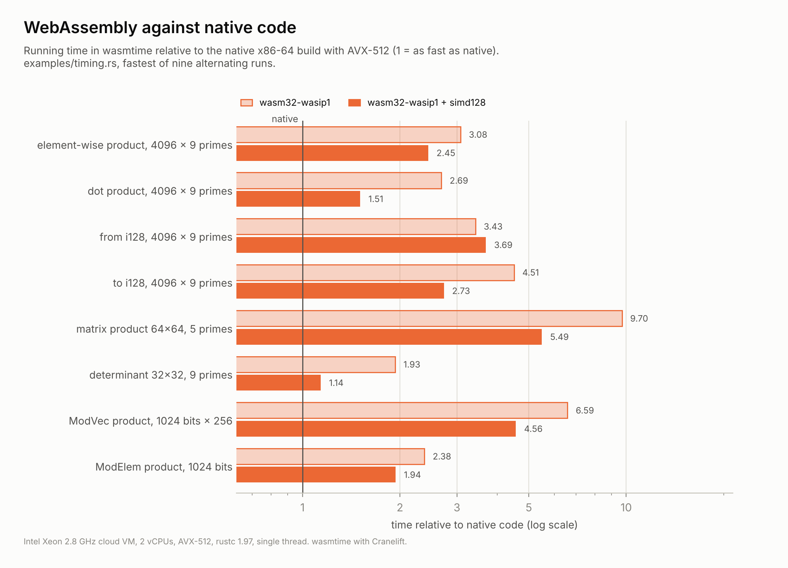

# Design of residue-rs

This document describes the mathematics behind residue-rs and the decisions
taken while building it. It started as a plan written before any code, and was
revised as the implementation showed where the plan was wrong; those
corrections are recorded where they happened. Benchmark numbers live in the
README.

## Goal and scope

residue-rs is a library for exact integer arithmetic in a Residue Number System
(RNS), running on CPUs, with a SIMD path for arrays and matrices. It is meant
for programs that perform many operations on integers of moderate size, roughly
64 to 2000 bits: exact dot products, element-wise products over large arrays,
matrix products, determinants, and similar workloads.

Some things are deliberately out of scope. The library does not try to beat GMP
on a single multiplication of very large numbers, where GMP's algorithms are
the right tool. It does not replace `u64` or `i128` for values that fit in
them. It does not compress anything either: an RNS representation uses slightly
more memory than binary (about 3 percent with 31-bit moduli, plus a redundant
channel). The gain is in time, not in space.

## The central trade-off

Every design choice follows from one observation. With `n` channels, an
addition or multiplication in RNS costs `O(n)` word operations, and these are
independent of each other, so they run in parallel. Converting a number into
RNS or back to binary costs `O(n²)`. The total cost of a computation is

```
total = C_in + k · C_op + C_out
```

and RNS only pays off when the number of operations `k` per conversion is
large compared to `n`. The library therefore has three jobs: make operations
inside RNS cheap, make it rarely necessary to leave RNS (which means comparison,
sign and base extension must work without converting back, and these are
exactly the classical weak points of RNS), and provide operations such as dot
products and matrix products in which `k` is large by construction.

## Two types for two kinds of arithmetic

For a base of distinct primes `m_1, ..., m_n` with product `M`, the Chinese
Remainder Theorem gives a ring isomorphism

```
φ : ℤ/Mℤ → ℤ/m_1ℤ × ... × ℤ/m_nℤ,    x ↦ (x mod m_1, ..., x mod m_n)
```

This is an isomorphism of `ℤ/Mℤ`, not of `ℤ`. Most users want true integers, so
the library keeps the two worlds apart. `RnsMod` is an element of the ring
`ℤ/Mℤ`: it never overflows and has no sign or order, since `ℤ/Mℤ` is not an
ordered ring. `Rns` is an exact signed integer: it carries extra information
that makes sign, comparison and overflow detection exact, and it refuses any
operation whose result might not fit.

## Choice of moduli

The moduli are distinct odd primes below `2^31`, and residues are stored in
`u32`. Three reasons decided this. Vector instruction sets offer a 32 by 32 to
64 bit multiplication (`vpmuludq` on x86, `vmull_u32` on ARM) but no 64 by 64
to 128 bit one, so 32-bit residues are what SIMD can multiply. Keeping one bit
of headroom means that `a + b` never overflows a `u32`, which makes modular
addition branchless and leaves room for delayed reduction. Using primes rather
than merely coprime moduli makes every channel a field, so every non-zero
residue is invertible; this is needed for exact division and for the
determinant.

A base of `n` such primes covers about `31n` bits. The `largest_primes` table
starts at `2^31 − 1`, which is itself prime (the Mersenne prime `M31`).

## Arithmetic in one channel

Everything rests on a `Channel`: one prime `p` together with a few precomputed
constants.

Addition computes `s = a + b`, which fits in 32 bits, and returns
`min(s, s − p)` with a wrapping subtraction. If `s ≥ p` the subtraction gives
the smaller value; otherwise it wraps around to something larger than `s`. There
is no branch, and in SIMD this is a single `pminud`. Subtraction works the same
way.

Multiplication uses Montgomery form with `R = 2^32`: a residue `a` is stored as
`ã = a·R mod p`, and the reduction `REDC(t) = t·R⁻¹ mod p` needs three 32-bit
multiplications and no division. The constant `−p⁻¹ mod 2^32` is computed by
Newton-Hensel lifting, starting from `p` itself, which is correct modulo 8 for
every odd `p`; five steps give all 32 bits. Multiplication by a fixed constant,
used in Garner's algorithm, follows Shoup's method with a precomputed quotient
estimate. Inverses come from Fermat's little theorem, `a⁻¹ = a^(p−2)`.

## Bases at compile time

A base is declared with the `rns_base!` macro, which creates a zero-sized
marker type. Numbers on different bases are therefore different types and
cannot be mixed by accident. `Base::new` is a `const fn`: it checks that every
modulus is a prime in `[3, 2^31)` with a deterministic Miller-Rabin test
(witnesses 2, 3, 5 and 7 are exact below `3 215 031 751`), rejects duplicates,
and computes all constants, including `M`, the cofactors `M_i = M/m_i`, the CRT
coefficients and the conversion tables. Because the base lives in a `static`, an
invalid base is a compile error.

## The redundant channel

`Rns` stores, besides the `n` residues, the value `x mod 2^64`, maintained with
ordinary wrapping `u64` arithmetic. This channel follows the true signed
integer `x`, not its representative in `[0, M)`, which is only valid as long as
no operation leaves the allowed range; range tracking guarantees that.

With `M_i = M/m_i`, `y_i = M_i⁻¹ mod m_i` and `ξ_i = r_i·y_i mod m_i`, the
sum `S = Σ ξ_i·M_i` satisfies `S ≡ x (mod M)` and `0 ≤ S < n·M`, so
`S = x + α'·M` for an integer `α'` between 0 and `n`. Reducing modulo `2^64`,
where `M` is invertible because it is odd,

```
α' = (S mod 2^64 − x mod 2^64) · M⁻¹ mod 2^64
```

and both terms on the right are known: `S mod 2^64` is a wrapping sum, and
`x mod 2^64` is the redundant channel. Since `α' ≤ n`, the value is exact. This
is the method of Shenoy and Kumaresan (1989), adapted so that the redundant
channel tracks the signed integer. It gives the exact signed value
`x = S − α'·M` without Garner's sequential chain, and it is the basis of base
extension and of the sign test. The `R⁻¹` factor of the Montgomery form costs
nothing here: a Montgomery product of `r̃_i` with the ordinary constant `y_i`
yields `ξ_i` directly in ordinary form.

## Conversions

To convert a binary integer into RNS, each 64-bit limb `ℓ = h·2^32 + l` at
position `j` is split into two halves. With a precomputed table of
`R²·2^(64j) mod p` and `R³·2^(64j) mod p`, the Montgomery residue of the whole
number is a sum of `REDC(l·c_lo) + REDC(h·c_hi)` over the limbs, with no
division. A first version used 128-bit divisions and cost ten times more.

The reductions themselves need not be done one by one. REDC is linear modulo
`p`, so the sum of reductions equals one reduction of the sum. The raw products
(each below `2^63`) are accumulated in two 64-bit halves, `lo = Σ lo32(t)` and
`hi = Σ hi32(t)`, and reduced once: `(hi·2^32 + lo)·R⁻¹ = (hi mod p) + REDC(lo)`,
with `hi mod p = to_mont(REDC(hi))`. That is three reductions per channel
however long the input, against two per limb before. Measured against 0.1.0
in alternating runs, the scalar conversion became 1.3 to 1.9 times faster on 9
channels and about 3.4 times on 68 (an earlier figure of 13 for 9 channels came
from a flawed benchmark; see Measuring). The same step,
`Channel::redc_halves`, ends the dot product, the matrix product and base
extension. It requires both halves below `p·2^32`, which holds whenever fewer
than `p` products were summed; `Channel::reduce_halves` falls back to two
divisions for bases of very small primes.

Converting back uses `x = S − α'·M`, computed in two's complement over only the
limbs that the value's certified bound needs, `⌈(bits + 1)/64⌉`: never more
than `ceil(bits(M)/64)`, about half of `n`, and only two for a value that fits
`i128`, whatever the base. That alone makes `to_i128` 1.4 times faster on 9
channels and 4 to 4.7 times on 36. `S = Σ ξ_i·M_i` is built by product
scanning: limb `j` of the result is `Σ_i ξ_i·M_i[j]`, summed in a `u128` from
one contiguous column of a table stored by columns, and a single carry runs
through the result. The first version added each `ξ_i·M_i` with its own carry
chain; scanning by columns is 1.2 to 1.3 times faster on bases of 36 and 68
channels. On 9 channels the scalar conversion is about 15 percent slower than
in 0.1.0, for a reason not yet found (see Measuring). A variant with 32-bit
digits, which would let the column sums use SIMD, was twice as slow: outside
the dispatched kernels the code is compiled for baseline x86-64, and there a
single 64×64→128 multiplication beats two 32-bit ones plus horizontal sums. For `RnsMod`, and for results whose redundant channel is unknown, such as a
division candidate or a determinant, Garner's mixed-radix algorithm is used
instead, since it needs only the residues.

## Range tracking

Every `Rns` carries a certified bound `bits` with `|x| < 2^bits`. Addition and
subtraction give `max(a, b) + 1`, multiplication gives `a + b`, and negation
keeps the bound. The largest allowed bound is `max_bits = bits(M) − 2`, which
guarantees `|x| < M/2` and therefore a unique signed representative.

An operation whose bound would exceed `max_bits` is refused. The `checked_`
methods return `None`, and the operators panic. Unlike primitive integers in
release builds, they never wrap, because a wrapped value would silently break
the redundant channel. Bounds can become pessimistic, for instance after
`(a + b) − b`, and `tighten` replaces the bound with the exact bit length at the
cost of one reconstruction.

Comparison never needs a larger bound. If the signs of `a` and `b` differ, they
decide. If they agree, `|a − b| < max(|a|, |b|)`, so the difference fits under
the existing bound and its sign is the answer.

## Sign detection

Sign is the classical problem of RNS. The plan proposed a fixed-point estimate
of `x/M` with about `log2 M` bits of precision. During implementation it turned
out that at that precision the estimate costs `n²/2` word operations, the same
as reconstructing `x` outright, so it was no faster. The implemented test has
three tiers and is exact in all of them.

When the bound certifies `|x| < 2^63`, the redundant channel read as an `i64`
is `x` itself, and the sign costs nothing. Otherwise the test computes
`g = Σ ξ_i·⌊2^64/m_i⌋ − α'·2^64`, which satisfies
`g ≤ 2^64·x/M ≤ g + Σ ξ_i`; if that interval excludes zero, the sign is known
after `O(n)` work. This decides values that are large compared to `M`. The
values in between, roughly `2^63 ≤ |x| ≲ n·2^31·M/2^64`, fall back to exact
reconstruction.

The tests count which tier decides for values of every bit length and require
all three to be reached; on a base of 9 channels the split was 512, 296 and
1416 out of 2224 values. A possible improvement is to refine the second tier 64
bits at a time, so that the cost of the third tier grows with how small `|x|` is
compared to `M` instead of always being `n²/2`.

## Base extension

The residue of `x` modulo any new prime `q` is

```
x mod q = (Σ ξ_i·(M_i mod q) − α'·(M mod q)) mod q
```

which is exact because `α'` is exact. With the table `M_i mod q_j` computed
once, an `Extender` moves a value between two bases in `O(n_s · n_t)` word
operations, with no reconstruction. The table is stored multiplied by `R²`, so
the sum for one target channel is a delayed-reduction dot product whose single
`redc_halves` turns `R²` into the `R` of Montgomery form; the first version
reduced it with two 128-bit divisions per target channel. Moving to a wider base makes room for
larger results; moving to a narrower one succeeds when the value fits.

## Division

Division cannot be done locally: `ℤ/Mℤ` is not a domain, and each digit of a
quotient depends on the whole number. The general operators (`/`, `%`,
`div_euclid`, `rem_euclid`) therefore reconstruct both operands, divide in
binary and convert back, at a cost of `O(n²)`. When every in-range value fits in
two limbs, native `u128` division is used. Otherwise the division is Knuth's
Algorithm D with 64-bit digits. Its rare "add back" correction, taken with
probability about `2^−63` on random inputs, is exercised by tests built from
boundary digits (0, 1, `2^63`, `2^64 − 1`), where it runs thousands of times.

Exact division is cheaper. If `y` divides `x`, the quotient is `x·y⁻¹` in
every channel, and the residues of the candidate `q` cost `O(n)` plus one
inverse per channel. The library proves that the candidate is the quotient
rather than assuming it. Let `bq` and `by` be the exact bit lengths of `q` and
`y`. If `y` divides `x`, the true quotient is in range and has the same
residues, so it is the candidate. If `bq + by ≥ bits(M)`, then
`|q·y| ≥ 2^(bq+by−2) ≥ 2^max_bits > |x|`, so `q·y ≠ x`. Otherwise `|q·y| < M`,
and `q·y ≡ x (mod M)` forces `q·y − x` to be one of `−M`, 0 or `M`; since `M` is
odd, the redundant channel tells 0 apart from `±M`. When `y` shares a prime
with `M`, it has no inverse and the general division is used.

## Batches

A scalar `Rns` keeps the residues of one number side by side, each with a
different modulus. `RnsVec` turns this around: channel `i` is one contiguous
`Vec<u32>` holding residue `i` of every element, next to a `Vec<u64>` for the
redundant channel and a single bound for the whole vector. A channel is then
processed with a single modulus, broadcast once, which is the shape SIMD needs.

The kernels are plain loops without branches, written so that LLVM vectorizes
them. With the `std` feature they run inside a function compiled for AVX2 or
AVX-512, chosen at runtime through the `pulp` crate, so the crate itself
contains no `unsafe` code. One lesson came from measuring: a closure passed to
`pulp` is not inlined into the function compiled for AVX, so the first version
ran SSE2 code on the AVX path. The timings and the generated assembly both
showed it. Every batch operation is now a concrete type whose `run` method is
`inline(always)`.

The dot product uses delayed reduction. Each product of two residues is below
`p² < 2^62`; its low and high 32-bit halves go into two separate `u64` sums,
which cannot overflow for fewer than `2^32` terms. The loop contains only a
multiplication, a mask, a shift and two additions, and each channel is reduced
once at the end.

## Batch conversions

`RnsVec` converts whole vectors to and from binary, with loops that run over
many elements with the same constants.

From binary, each element's magnitude limbs are stored limb-major, and every
channel accumulates, for a block of elements, the products of the two 32-bit
halves of each limb with the base's power table, then reduces once and negates
where needed. Against 0.1.0, which converted one value at a time, this is 3.0
times faster on 9 channels, 4.5 on 36 and 5.1 on 68.

To binary, modulo `2^(64w)` subtracting `α'·M` equals adding
`α'·(2^(64w) − M)`, so `α'` becomes one more row of `Σ ξ_i·M_i`, and the whole
conversion is a product scan: for each row and each 32-bit digit of the
result, every element of a block accumulates `x·d` in two halves, and a last
pass propagates the carries. Three refinements made this faster than the
scalar path rather than slower, and two attempts did not:

- *All digits of a row in one pass.* A first version ran one pass per row and
  per digit, a hundred short passes per block on 9 channels, and was no faster
  than converting one value at a time: it was bound by loading and storing the
  accumulators, not by arithmetic. Keeping all the digit sums of a block in
  one buffer at constant offsets lets one loop over the elements update every
  digit, and lets the compiler vectorize it without runtime alias checks,
  which it cannot rule out when each digit has its own array.
- *Rows in pairs.* `ξ < 2^31` and each digit is below `2^32`, so two products
  fit a `u64`: a pair of rows is summed in full and split into halves once,
  which halves the accumulator updates.
- *`α'` modulo `2^32`.* It is at most `N`, so 32 bits hold it, and its sum
  needs only 32-bit multiplications instead of 64-bit ones, which AVX2 lacks
  and AVX-512 runs as three micro-operations.
- *Discarded: accumulators in registers.* Processing eight elements at a time
  with every digit sum in a local array, so that it could live in registers,
  was vectorized by LLVM across digits instead of elements, with gathers and
  scatters, and was no faster; flattening the arrays, which fixed the same
  problem in the Phase 0 experiment, did not help here. This is the shape for
  explicit vector types.

Measured against 0.1.0 on the same machine: `to_i128s` is 2.5 times faster
than converting one value at a time on 9 channels and 17 times on 36; at full
width the gain is only 1.1 to 1.3 times. The full-width case is still limited
by memory traffic and is the next candidate for explicit SIMD.

## Matrices and determinants

`RnsMatrix` stores its entries in an `RnsVec` in row-major order, so each
channel is a contiguous matrix of residues and the matrix product is `n`
independent `u32` matrix products. Each channel is dispatched as its own
operation: with all channels in one dispatched body, unrelated changes
elsewhere in the crate made the product 28 percent slower than in 0.1.0, and
dispatching per channel brought it back to the same speed. The inner loop multiplies one entry of the
left matrix by a row of the right one, which vectorizes across columns, and
accumulates the two 32-bit halves as in the dot product. The final reduction
needs no division. The products are of Montgomery forms, `t = ab·R²`, and the
wanted result is `Σab·R = Σt·R⁻¹`. With `Σt = h·2^32 + l` and `R = 2^32`, that
is `h + REDC(l)`, and `h mod p = to_mont(REDC(h))`: three reductions per output
entry. This requires the inner dimension to be below the smallest modulus;
otherwise a slower path with divisions is taken.

The determinant uses the multi-modular method instead of fraction-free Bareiss
elimination. Gaussian elimination runs separately over each field `ℤ/m_iℤ`,
each channel choosing its own pivots, since a zero modulo one prime is not a
zero modulo another. The `n` determinants are then combined by the CRT.
Hadamard's inequality bounds the result in advance: with `n` rows and entries
`|a_ij| < 2^b`, `|det A| < 2^(n·b + ceil(n·ceil(log2 n)/2))`, and the
computation is refused if that exceeds `max_bits`. Intermediate values never
need to fit in the range, because the whole elimination happens modulo `M` and
only the final determinant has to be in range.

## Explicit vector kernels

The rest of the crate leaves vectorization to LLVM: plain loops over slices,
compiled inside a function enabled for AVX2 or AVX-512. That works for one
loop over contiguous data and fails for a register-blocked tile, where LLVM
tends to vectorize along the wrong dimension (Phase 0 experiment; Phase 1
attempts). It also leaves the speed of a hot loop at the mercy of code layout:
the same matrix loop ran in 414 µs in one build and 560 µs in another, with
nothing changed in the loop itself.

Two kernels are therefore written with explicit x86 intrinsics, in
`src/batch/x86.rs`. `pulp` exposes each intrinsic as a method of a token type
that can only be obtained on a CPU with the feature, so calling one is safe and
the crate keeps `forbid(unsafe_code)`. Vector values move to and from arrays
with `bytemuck` casts.

- *Matrix product.* A tile of output sums stays in registers for the whole
  loop over the inner dimension: 2 rows × 8 columns with AVX2 (12 of 16
  registers), 4 × 16 with AVX-512 (24 of 32). Residues are below `2^31`, so a
  product is below `2^62` and four products are summed in a `u64` before the
  split into 32-bit halves, which divides the delayed-reduction work by four.
  Measured in one binary against the portable kernel: 1.48 times faster on a
  64×64 product with 5 channels, 1.64 with 40 channels and 1.87 on 256×256,
  with AVX-512; 1.13 to 1.24 with AVX2 on the same machine (where the portable
  kernel itself runs with AVX-512).
- *Conversion to binary, up to 6 limbs.* For a group of eight elements, the
  `2D` digit sums of the product scan stay in AVX-512 registers while the rows
  (the `ξ_i`, then `α'`) stream past in pairs. 1.3 times faster than the
  portable kernel for 9 channels at full width, 1.2 times for `i128`.

A hidden hook, `__set_simd_level`, makes the kernels choose AVX2 or the
portable path even on an AVX-512 machine, so that the tests run every kernel
and the benchmarks compare them in one binary, where code layout cannot tilt
the result.

## Parallelism

With the `parallel` feature, large operations spread over rayon's global
pool. The channels are independent, so most of this is direct: a determinant
is `N` eliminations, conversions from binary fill `N` channels. The matrix
product splits into tasks of (channel, block of rows), so that a base with
fewer channels than threads still uses every thread, and runs the redundant
channel alongside. The conversion to binary combines all channels of an
element, so it splits by ranges of elements instead. Each task enters its SIMD
kernel through the same dispatch as the sequential code.

Splitting has a cost: waking the threads of the pool took tens of
microseconds on the measuring machine. An operation runs in parallel only
above `2^19` word multiplications, roughly 150 to 300 µs of sequential work;
elimination counts double, since each of its steps costs about twice a
product's. A first threshold of `2^17` made the conversion of 4096 values 25
percent slower with two threads than with one.

## Arithmetic modulo a large odd number

`MontRns` holds the constants for one odd modulus `m`, chosen at run time;
`ModElem` is one element of `ℤ/mℤ` and `ModVec` many. This is RNS Montgomery
multiplication (Bajard, Didier and Kornerup; Kawamura et al.), with two bases
`B` (product `M`, `n = N1` primes) and `B'` (product `M'`), no prime in
common, plus the redundant residue modulo `2^64`. Elements are in Montgomery
form `x̃ = x·M mod m`, stored in every channel of both bases.

### The product

For `ã` and `b̃`:

1. `c = ã·b̃` in every channel, and modulo `2^64`.
2. `q = c·(−m⁻¹) mod M` in `B`. With `ξ_i = q_i·M_i⁻¹ mod m_i`, steps 2 and
   the first half of 3 are one Montgomery product per channel, by the constant
   `w_i = −m⁻¹·M_i⁻¹ mod m_i`.
3. `q̂ = Σ ξ_i·M_i` in `B'` and modulo `2^64`. Since `0 ≤ ξ_i < m_i`,
   `0 ≤ q̂ < Σ m_i·M_i = n·M`, and `q̂ ≡ q (mod M)`: this is the *inexact*
   extension, off by an unknown multiple `α·M`, `α < n`. Nothing needs `α`:
   `q̂` is an exactly defined integer, so all of its residues, including the
   one modulo `2^64`, are computed exactly.
4. `r = (c + q̂·m)/M`. Because `q̂ ≡ q ≡ −c·m⁻¹ (mod M)`, `M` divides
   `c + q̂·m`, so `r` is an integer and its residues in `B'` are
   `(c + q̂·m)·M⁻¹ mod m'_j`, and modulo `2^64` the same with `M⁻¹ mod 2^64`
   (`M` is odd). From `r·M = c + q̂·m`, `r ≡ c·M⁻¹ = ã·b̃·M⁻¹ (mod m)`, the
   Montgomery form of `a·b`.
5. `r` is extended from `B'` to `B` exactly, by the method of Shenoy and
   Kumaresan that `Extender` already implements, using the redundant residue
   of `r` from step 4.

### Bounds

Elements are never reduced to `[0, m)` inside RNS; each carries a factor `f`
with value `< f·m`. Write `M > 2^s·m` (`s = bits(M) − 1 − bits(m)`). For
`a < f_a·m` and `b < f_b·m`, `c < f_a·f_b·m²` and, from step 3,

```
r = (c + q̂·m)/M < c/M + n·m < (f_a·f_b·m/M + n)·m < (⌊f_a·f_b/2^s⌋ + 1 + n)·m
```

so the product's factor is `f_out = ⌊f_a·f_b/2^s⌋ + 1 + n`. Step 5 needs
`r < M'/2` (the signed range of `B'`) and a bound within `B`'s range:
`bits(f_out) + bits(m) ≤ min(max_bits(B), max_bits(B'))`, where
`max_bits = bits − 2`. Let `room = min(max_bits) − bits(m)`.

The context fixes a largest factor `F = 2^t` with `t = ⌊(room − 2 + s)/2⌋`.
For `f_a, f_b ≤ F`, `⌊f_a·f_b/2^s⌋ ≤ 2^(2t−s) ≤ 2^(room−2)`, and with
`n + 1 < 2^(room−2)`, `f_out < 2^(room−1)`: every product of two elements
of factor at most `F` fits, so products never fail. Sums add factors; when a
sum would exceed `F`, its operands are first normalized, multiplied by the
Montgomery form of 1 (value `< m`, factor 1). Always
`room ≤ max_bits(B) − bits(m) = s − 1`, so `t < s` and `⌊f/2^s⌋ = 0` for
`f ≤ F`: a normalized element has factor at most `n + 1`, and two of them sum
to at most `2(n + 1) ≤ F`. Subtraction adds `f_b·m − b`, which is non-negative and has
the factor of `b`.

The constructor requires `bits(M), bits(M') ≥ bits(m) + 2·bits(n + 2) + 5`.
Then `s ≥ 2·bits(n+2) + 4` and `room ≥ 2·bits(n+2) + 3`, so
`t ≥ 2·bits(n+2) + 2`, hence `F ≥ 4·(n + 2)` and `n + 1 < 2^(room−2)`.

Debug builds check `0 ≤ r < f_out·m` after every product. The randomized
tests cannot reach the worst case: with random data `α` is about `n/2`, not
`n − 1`, so values stay roughly a factor of two below the bound per operand.
A deliberately loosened `F` (four times too large) passed every test, while
an under-estimated `f_out` failed at once. The bound itself rests on the
argument above, and the debug check turns any real violation into a panic.

### Batches

One product costs about `2·n·n'` word products, more than a big-integer
library spends on one product of the same size. `ModVec` stores elements
channel by channel and processes blocks of 256: step 3 is then the matrix
product `Q̂ = T1·Ξ` (`n' × n` table times `n × 256` coefficients) and step 5
`R = T2·Ξ'`, on the register-tiled kernels, with the prime of each output row
chosen per row. The element-wise steps are vectorized loops. Building this
showed that the scalar reduction at the end of each tile (three Montgomery
reductions per output) cost about as much as the products, since an output
sums only 64 to 70 of them; the tiles now reduce with vector instructions.

### Measured

`benches/modular.rs`, one thread, the 2-vCPU AVX-512 VM of the other
sections, medians of three sessions; GMP through `rug`. Bases of 35 + 35
primes for 1024 bits and 70 + 70 for 2048.

| | residue | GMP | num-bigint |
|---|---|---|---|
| product, 1024 bits | 1.6 µs | 0.51 µs | 0.84 µs |
| product, 2048 bits | 8.9 µs | 1.7 µs | 2.8 µs |
| exponentiation, 1024-bit exponent | 2.0 ms | 0.42 ms | 0.61 ms |
| exponentiation, 2048-bit exponent | 21.2 ms | 2.8 ms | 4.9 ms |
| 256 exponentiations, 256-bit exponent, 1024 bits | 41.8 ms | 29.1 ms | 37.9 ms |
| same, 2048 bits | 125 ms | 94.6 ms | 158 ms |

One element at a time, RNS loses to GMP by 3.2 to 7.6 times, as the
operation count predicted. In batches the gap closes to 1.4 times (1024 bits)
and 1.3 times (2048 bits). Against num-bigint the batch wins at 2048 bits
(1.3 times) and loses at 1024 bits (num-bigint is 10 percent faster; an
earlier session had measured num-bigint at 56 ms there, and the three sessions
of the final measurement all gave 37 to 40 ms). The same 256 exponentiations
through `ModElem` one by one take 142 ms and 742 ms, so the batch layout is
worth 3.4 to 5.9 times. With the `parallel` feature and two threads the
2048-bit batch takes 112 to 120 ms against 125 on one thread, which is little
on this machine; GMP's loop over 256 independent exponentiations could be
split just as easily.

Where a batch product goes (2048 bits, 256 elements, about 400 µs): the two base
extensions take 80%, the element-wise steps 2 to 5% each. The extensions run
at about 0.36 cycles per word product, against 0.125 for one 512-bit
multiplication per cycle. In the tile loop, eight multiplications share two
loads and four broadcasts, which compete for the same shuffle port; the
32-bit splits every four products add a third more vector operations. Pulling
the row slices out of the loop (it had bounds checks on every iteration) was
worth 5 to 10%; a 32-bit broadcast straight from memory would free the
shuffle port, but LLVM keeps it in a general register.

The two-thread split of one product is weighted so that a 1024-bit batch of
256 stays on one thread: split in two, each half took about 70 µs, too
little to cover waking the pool, and the batch was 10% slower.

Bases above about 100 primes (4096-bit moduli need 134 + 134) make rustc's
constant evaluation of the tables slow enough to trip the
`long_running_const_eval` lint, which the crate using them must allow; the
4096-bit test does.

## ARM and WebAssembly

The portable kernels are plain loops that LLVM vectorizes for whatever the
target offers; the explicit kernels exist for x86 only. Phase 4 checked what
that gives on the two other targets that matter, aarch64 and WebAssembly.
Both test suites pass there, under `qemu-aarch64` and `wasmtime`, with and
without SIMD. Getting there found three bugs that x86 hid:

- With `alloc`, the crate did not compile for any 32-bit target: a length
  check in the dot product compared with `1usize << 32`.
- With `parallel` on WebAssembly without threads, the first parallel
  operation panicked. `std` reports the failure to create a thread as
  `WouldBlock`, and rayon falls back to one thread only on `Unsupported`.
  The crate now uses rayon only inside a rayon pool, or on targets that can
  have threads and report more than one hardware thread.
- proptest's default features (`fork`, `timeout`) do not build for
  WebAssembly, so the WebAssembly CI job could never have run.

### aarch64

NEON is part of the base architecture, so the portable kernels are always
compiled for it (`pulp` reports NEON on every aarch64 CPU). The assembly of
the three loop shapes every batch kernel is built from, a dot product in
32-bit halves, a row of a matrix product and the element-wise Montgomery
product, shows them vectorized with `umull`/`umull2`, the 32×32→64 multiply,
four products per pair of instructions. With no ARM machine at hand, llvm-mca
gives a static estimate per product (Neoverse N1 / V1, the cores of Graviton 2
and 3): dot product 1.0 / 0.5 cycles, Montgomery product 1.0 / 0.5, matrix row
1.6 / 0.5. The matrix row is the weak one: its accumulators go through memory
at every step of the inner dimension, which the x86 kernels avoid by keeping a
tile of sums in registers. A NEON tile would likely help the matrix product
and the `ModVec` base extensions, but was not written, because nothing here
could measure it. The CI job `timing` runs `examples/timing.rs` on ARM Linux
and Apple Silicon runners, to get real figures.

### WebAssembly

WebAssembly has no runtime feature detection: SIMD is on only if the whole
crate is compiled with `-C target-feature=+simd128`, and a module built that
way does not load in a runtime without SIMD. Without the flag the crate runs
scalar code.

With the flag, LLVM vectorized the loops, but with `i64x2.mul`, a full 64×64
multiply. Neither SSE nor NEON has one, so runtimes expand it into several
instructions, and the element-wise product became slower than the scalar
build. The 32×32→64 instruction exists (`i64x2.extmul_low_i32x4_u`, one
`pmuludq` or `umull`), but writing it explicitly is not enough: LLVM rewrites
it back into `i64x2.mul` when an operand is a load (split into two extending
loads) or a value hoisted out of the loop. `src/batch/wasm.rs` therefore
passes the operands of each `extmul` through `core::hint::black_box`, which
keeps them opaque at the price of a store and a load each. It replaces the dot
product, the matrix row and the element-wise Montgomery product when simd128
is on.

`examples/timing.rs` in wasmtime (Cranelift) on the x86-64 VM of the other
sections, µs. Whole runs were sometimes twice as slow, native code included,
so each figure is the fastest of nine alternating runs (each run itself
reports the median of many calls):

| | native (AVX-512) | wasm | wasm + simd128 |
|---|---|---|---|
| element-wise product, 4096 × 9 channels | 16.1 | 49.6 | 39.4 |
| dot product, 4096 × 9 channels | 12.8 | 34.4 | 19.3 |
| from `i128`, 4096 × 9 channels | 77.1 | 264 | 284 |
| to `i128`, 4096 × 9 channels | 43.7 | 197 | 120 |
| matrix product 64×64, 5 channels | 193 | 1871 | 1058 |
| determinant 32×32, 9 channels | 135 | 261 | 154 |
| `ModVec` product, 1024 bits, 256 elements | 119 | 784 | 543 |
| `ModElem` product, 1024 bits | 3.4 | 8.1 | 6.6 |

simd128 is worth 1.2 to 1.8 times over scalar WebAssembly, except for the
conversion from `i128`, where it is 7 percent slower. Before the explicit
kernels the element-wise product took two to three times its scalar time with
simd128; against that build the explicit kernels were 2.5 times faster on it
and 11 to 14 percent faster on the dot product, the matrix product and the
`ModVec` product. Native code stays 1.1 to 5.5 times faster than simd128 and
1.9 to 9.7 times faster than scalar WebAssembly, most where the x86 kernels are
explicit.

<picture>
  <source media="(prefers-color-scheme: dark)" srcset="docs/wasm-dark.png">
  
</picture>

## Python bindings

Python has no const generics, and the number of primes is a type parameter
here. Two ways out were considered in the roadmap: a base whose size is chosen
at run time (`Vec` instead of arrays, in the library itself), or a fixed menu
of bases compiled into the bindings. The bindings take the second: 14 bases of
2 to 64 primes for integers, chosen by `Base(bits=…)`, and 8 pairs of 5 to 133
primes for moduli of up to 4096 bits, chosen from the modulus. Each entry is
an enum variant holding the library's own type, and a macro writes the
dispatch. The library stays as fast as from Rust, and nothing in it changed;
the price is size, about 14 MB of machine code, a 5 MB wheel.

`MontRns` elements borrow their context, which a Python object cannot hold.
`Modulus` therefore offers whole batches instead of element objects:
`pow_batch` and `mul_batch` convert in, compute and convert out in one call.
Converting costs about as much as a few dozen products, a tenth of an
exponentiation with a 256-bit exponent.

Converting Python ints turned out to matter more than the arithmetic for
simple operations. Under the stable ABI (one wheel for all Python versions),
PyO3 reads a big int through several Python-level calls: 466 ns per 100-bit
value, against 3 ns per value for the dot product itself. The bindings read
each list in the narrowest form that holds every value: `i64` (40 to 60 ns
per value), `i128` (a mask and a shift, 93 ns), and otherwise one call of
`int.to_bytes` per value into two's complement limbs, which the library
converts in one vectorized pass (300 ns at 200 bits).

## Costs

| Operation | `RnsMod` | `Rns` |
|---|---|---|
| addition, subtraction, multiplication | O(n) | O(n) |
| conversion from binary | O(n·L) | O(n·L) |
| conversion to binary | O(n²), Garner | O(n²), no sequential chain |
| extension to one new modulus | | O(n) |
| sign and comparison | not defined | O(1), O(n) or O(n²) by tier |
| general division | | O(n²) |
| exact division | | O(n) plus one reconstruction |

Here `L` is the number of 64-bit limbs of the binary input.

## Testing

Every operation is checked against `num-bigint`, an independent implementation,
with property tests on bases from 1 to 16 channels. These include a base of very
small primes (3 to 13) and a base mixing large and small primes, which reach code
paths that bases of large primes never touch. Generated values have a bit length
chosen uniformly at random, so small, medium and near-full-range values all
appear. Some branches are rare enough to need dedicated tests: the three sign
tiers, the add-back step of Algorithm D, determinants divisible by moduli of the
base, and dot products of hundreds of thousands of maximal residues. The SIMD
build and the scalar build run the same suite, and so does a debug build, where
Rust checks every arithmetic overflow.

## Measuring

Three lessons from benchmarking shaped the code. The closure problem described
above was invisible until the generated assembly was inspected. Without
`black_box` on the inputs, the compiler moved pure computations out of the
timed loop, and an early measurement showed a result faster than AVX-512 should
allow. Beyond about a million elements, element-wise operations are limited by
memory bandwidth, at about 10 ns per element whatever the instruction set.

A fourth lesson came from the cloud machine itself. During one run the session
moved to a different processor model, and the matrix product of residue went
from 0.33 ms to 0.41 ms while GMP and FLINT did not change. Results are only
compared within a single run. For version 2.0 even that was not enough: two
complete sessions an hour apart differed by up to 1.75 times on single
benchmarks, in both directions and for every library. The published figures
are therefore medians of three complete sessions of all libraries (criterion
and FLINT), and for the WebAssembly timings, where whole runs were sometimes
twice as slow, the fastest of nine alternating runs.

Phase 0 and Phase 1 of the roadmap added three more, the hard way, because
figures first published in the changelog had to be withdrawn.

- *A benchmark must consume all of its result.* A conversion benchmark that
  kept only the first residue of each value let the compiler drop the work of
  the other channels, and reported a speed-up of 13.6 for a change worth 1.7.
  Every benchmark now folds every residue or every limb into its result.
- *Two versions are compared in the same run, interleaved.* On the shared
  virtual machine the same code measured 792 µs at one point of a session and
  569 µs an hour later. A baseline saved at the start and compared at the end
  measures the machine as much as the change. Old and new code are now run
  alternately, three rounds each, and a result counts only if every round
  agrees.
- *Each version gets its own target directory.* Building version 0.1.0 from
  a git worktree into the project's target directory made Cargo reuse one
  library for both, since the packages have the same name and version; for a
  while "new" meant "old", and the comparison showed no difference at all.

A last observation is not yet a lesson, because its cause is unknown: the
scalar conversion to binary on 9 channels is 15 percent slower than in 0.1.0,
and putting back the exact 0.1.0 reconstruction made it slower still. The
speed of a short loop moves with changes elsewhere in the crate, as the
matrix product did in the Phase 0 experiment; code layout is the likely
cause, and it is recorded here rather than chased.

## Not done yet

### Wider moduli: measured, and rejected

FLINT is faster than residue on matrix products and on large determinants. It
uses the same multi-modular idea with primes of about 60 bits, so it needs
roughly half as many channels, and the obvious hypothesis was that this
explained the gap. Phase 0 of the roadmap tested it before changing any type,
with a prototype in `experiments/wide-primes`: 62-bit primes with Montgomery
arithmetic on `u128` products (scalar, since no vector instruction set has a
64×64→128 product), and 50-bit primes in `f64` with an exact FMA product
(vectorizable). The criterion, fixed in advance, was a speed-up of at least
1.3 over 31-bit primes on both the 64×64 matrix product and the 64×64
determinant.

Neither candidate met it, with AVX-512 or with AVX2. Against the best 31-bit
loop, 62-bit primes ran at 0.68 and 0.76 of its speed with AVX-512, 0.60 and
0.70 with AVX2; the `f64` variant tied on the determinant with AVX-512 and lost
everywhere else. Halving the channels does not pay for the 8 or 16 SIMD lanes
that 32-bit products allow. The moduli stay below `2^31`.

The experiment found where the gap is instead. The library's own matrix loop,
compiled as one function per channel, ran in 0.46 ms; the library took 0.74
ms for the same arithmetic. Part of the difference comes from putting every
channel in one function body, the rest is not isolated yet. Register tiling,
written as plain loops, was vectorized along the wrong dimension by LLVM with
AVX-512 (gathers and scatters) and needs explicit vector types. The redundant
channel costs about 8 percent of the product and is not the problem. The full
tables are in the experiment's README.

Other possible work includes Python bindings and an explicit NEON matrix
tile (see "ARM and WebAssembly").

## References

Szabó and Tanaka, *Residue Arithmetic and Its Applications to Computer
Technology*, 1967. Garner, "The residue number system", IRE Transactions on
Electronic Computers, 1959. Montgomery, "Modular multiplication without trial
division", Mathematics of Computation, 1985. Shenoy and Kumaresan, "Fast base
extension using a redundant modulus in RNS", IEEE Transactions on Computers,
1989. Bajard, Didier and Kornerup, "An RNS Montgomery modular multiplication
algorithm", IEEE Transactions on Computers, 1998. Kawamura, Koike, Sano and
Shimbo, "Cox-Rower architecture for fast parallel Montgomery multiplication",
EUROCRYPT 2000. Knuth, *The Art of Computer Programming*, volume 2, section
4.3.1. Shoup's constant multiplication is described in the NTL library.
