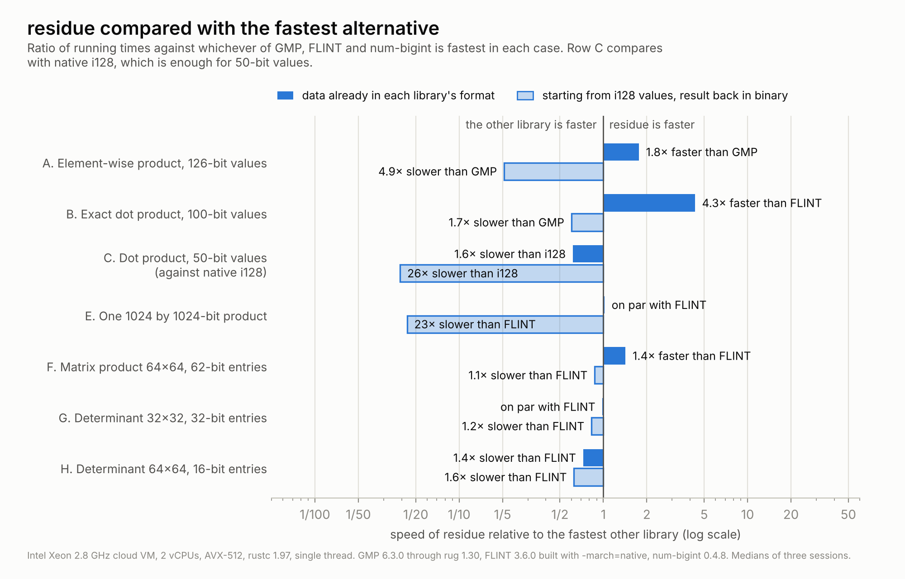
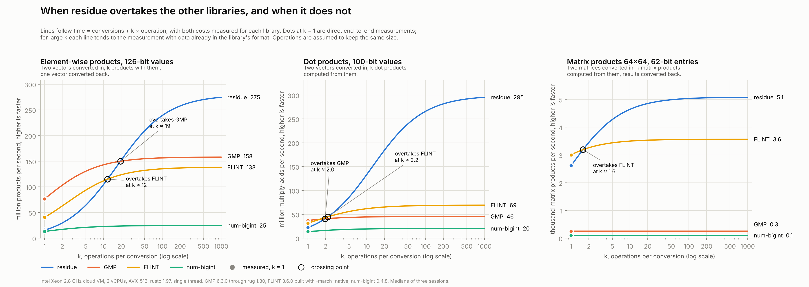
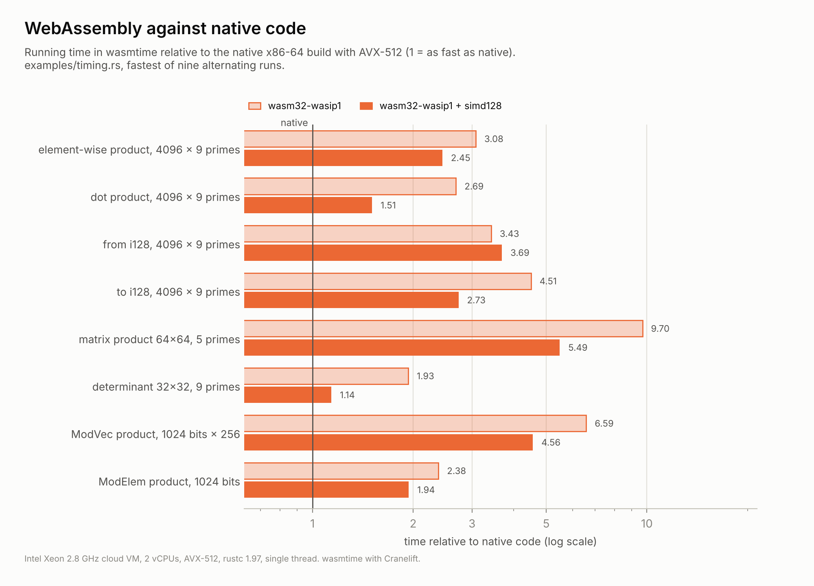

# residue-rs

Exact integer arithmetic in a Residue Number System (RNS) for Rust. The library
runs on the CPU, uses SIMD where it helps, works without the standard library,
and contains no `unsafe` code.

In a Residue Number System an integer is stored as its remainders modulo a set
of primes. Addition, subtraction and multiplication then work on each remainder
separately: no carry has to travel from one word to the next, so all the
remainders can be computed at once. residue-rs builds exact signed integers on
this idea. Overflow is always detected, sign and comparison are exact, and
division is available, all without converting back to binary first.

The approach has a clear strength and a clear weakness, and the benchmarks
below show both. Arithmetic on data that stays in RNS is fast: an exact dot
product of 100-bit integers runs 4.3 times faster than with FLINT and 6.6
times faster than with GMP. Converting into and out of RNS is slow, so a single
operation on binary inputs is much faster with GMP. On matrix products and
determinants residue is 3 to 20 times faster than GMP. Against FLINT, which
uses the same multi-modular idea in C, it is 1.4 times faster on a 64×64
matrix product, level on a 32×32 determinant and 1.4 times slower on a 64×64
determinant.

## Example

A base of 4 primes below `2^31` holds integers up to `2^122` in absolute
value, one of 9 primes up to `2^277`. The example compares two values exactly
without converting them to binary, moves a value to a wider base when a
result needs more room, processes a whole vector at once (dot product,
element-wise product and conversion back to binary), computes the determinant
of a matrix and divides. A product that overflows the base panics, and
`checked_mul` returns `None` instead.

```rust
use residue::{rns_base, Extender, Rns, RnsMatrix, RnsVec};

rns_base!(Narrow: largest 4);
rns_base!(Wide: largest 9);

let a: Rns<Narrow, 4> = "-123456789012345678901234567890".parse().unwrap();
let b = Rns::<Narrow, 4>::from_i64(42).unwrap();
assert!(a < b);
let c = a * b;

let ext = Extender::<Narrow, 4, Wide, 9>::new();
let big = ext.extend(&a).unwrap() * ext.extend(&a).unwrap();

let xs = RnsVec::<Wide, 9>::from_i128s(&[1, -2, 3]).unwrap();
let ys = RnsVec::<Wide, 9>::from_i128s(&[4, 5, -6]).unwrap();
assert_eq!(xs.dot(&ys).unwrap().to_i128(), Some(1 * 4 - 2 * 5 - 3 * 6));
assert_eq!((&xs * &ys).to_i128s(), Ok(vec![4, -10, -18]));

let m = RnsMatrix::<Wide, 9>::from_i128s(2, 2, &[3, 1, 4, 1]).unwrap();
assert_eq!(m.determinant().unwrap().to_i128(), Some(-1));
let m2 = &m * &m;

let x = Rns::<Wide, 9>::from_i64(91).unwrap();
let y = Rns::<Wide, 9>::from_i64(7).unwrap();
assert_eq!(x.div_exact(y).unwrap().to_i128(), Some(13));
assert_eq!((x % Rns::from_i64(10).unwrap()).to_i128(), Some(1));
```

## When to use it

One rule decides almost everything. With `n` primes in the base, an addition or
a multiplication inside RNS costs `O(n)` independent word operations, while
converting a number into RNS or back to binary costs `O(n²)`. RNS pays off when
a computation performs many operations for each conversion.

Linear algebra fits this rule well, because every entry of a matrix takes part
in many products: matrix products, determinants and long dot products are where
the library is strongest. Element-wise work on large arrays also benefits, as
long as the data stays in RNS for several operations.

It is the wrong tool in three situations. Values that fit in `i64` or `i128`
are faster with native integers. A computation that converts its inputs, does
one operation and converts the result back is faster with GMP. A single
multiplication of numbers with many thousands of bits is also better done by
GMP, whose algorithms for very large numbers this library does not try to
match. General division leaves RNS as well, so code that divides often loses
much of the advantage.

If you can link a C library, consider [FLINT](https://flintlib.org), which
does far more. In the measurements below it is 1.4 times faster than residue on
the 64×64 determinant and as fast on the 32×32 one, while residue is 1.4 times
faster on the matrix product (FLINT is 1.15 times faster there when the
conversion from `i128` is counted). The other reasons to choose residue are
these. It is pure Rust with no `unsafe` code,
so there is no C toolchain to set up and no LGPL library to link. It works
without the standard library. Its bases are checked at compile time and its
integers refuse to overflow instead of wrapping. And it lets you keep data in
RNS across many operations, which is where it is fastest of all.

## Arithmetic modulo a large odd number

`MontRns` multiplies modulo an odd number chosen at run time, of hundreds or
thousands of bits (an RSA modulus, a prime field), with RNS Montgomery
multiplication: every product stays in the residue channels, and no
big-integer product is ever formed. `ModElem` is one element, `ModVec` many.

The two bases must have no prime in common; with 6 + 6 primes they take moduli
up to 173 bits. The modulus is given as 64-bit limbs, least significant first,
here the prime `m = 2^127 - 1`. Since `2^127 = 1` modulo `m`, `2^200` reduces
to `2^73`; Fermat's theorem gives `a^(m-1) = 1` and the inverse. The batch type
`ModVec` is where RNS earns its keep.

```rust
use residue::{rns_base, ModVec, MontRns};

rns_base!(B1: largest 6);
rns_base!(B2: largest 6 after 6);

let m = [u64::MAX, u64::MAX >> 1];
let ctx = MontRns::<B1, 6, B2, 6>::new(&m).unwrap();
let a = ctx.from_u128(3);
let b = ctx.from_u128(1 << 100);
assert_eq!((a * a + a).to_u128(), Some(12));
assert_eq!((b * b).to_u128(), Some(1 << 73));
assert_eq!(a.pow(&[u64::MAX - 1, u64::MAX >> 1]), ctx.one());
assert_eq!(a * a.inv_prime(), ctx.one());

let v = ModVec::from_elems(&ctx, &[a, b, a + b]);
let w = v.pow(&[65537]);
assert_eq!(w.get(2), Some((a + b).pow(&[65537])));
```

<picture>
  <source media="(prefers-color-scheme: dark)" srcset="docs/modular-dark.png">
  
</picture>

Be clear about what to expect. One element at a time, GMP is 3.2 to 7.6 times
faster: an RNS Montgomery product at 2048 bits costs about 10 000 products of
32-bit words, GMP's about 2 000 products of 64-bit words. In batches the two
base extensions become matrix products on the vector kernels, and 256
exponentiations with one 256-bit exponent take 41.8 ms at 1024 bits (GMP 29.1
ms, num-bigint 37.9 ms) and 125 ms at 2048 bits (GMP 94.6 ms, num-bigint 158
ms), on one thread of the machine described under Benchmarks. GMP stays 1.3 to
1.4 times faster; residue beats num-bigint at 2048 bits but not at 1024. These
types are **not constant time**: do not use them with secret data.

## Python

The `python/` directory holds bindings, published separately as `residue-rs`
on PyPI and imported as `residue_rs` (Python 3.11 or later):

```python
from residue_rs import Base, Modulus

v = Base(bits=400).vector([1, -2, 10**50])
assert v.dot(v) == 5 + 10**100
assert Base(bits=500).matrix([[2, 1], [7, 4]]).det() == 1
assert Modulus(2**127 - 1).pow_batch([3], 65537) == [pow(3, 65537, 2**127 - 1)]
```

<picture>
  <source media="(prefers-color-scheme: dark)" srcset="docs/python-dark.png">
  
</picture>

On data kept in its vectors and matrices it is 7.5 times faster than
python-flint on a dot product and 2.3 times faster on a matrix product; for
batches of modular exponentiations GMP, through gmpy2 or python-flint, stays
1.5 to 2 times faster. Details in [python/README.md](python/README.md).

## Benchmarks

<picture>
  <source media="(prefers-color-scheme: dark)" srcset="docs/speedup-dark.png">
  
</picture>

Each scenario is measured in two ways. In the first, the data is already in each
library's own representation. In the second, every library starts from `i128`
values and returns the result in binary, so each one also pays for its own
conversions. The chart compares residue with whichever other library is fastest
in each case. GMP gets its best case in both measurements: preallocated values,
in-place assignment, and the fused `addmul` and `submul` operations. FLINT runs
its own default algorithms.

Element-wise products and dot products (rows A and B) are faster with residue
only while the data stays in RNS: 1.8 times faster than GMP on the element-wise
product and 4.3 times faster than FLINT on the dot product. Starting from
`i128`, the conversions cost more than the arithmetic and GMP wins, by 4.9 times
on the element-wise product. For 50-bit values (row C) native `i128` arithmetic
is faster than anything else. A single 1024-bit product (row E) takes 141 ns in
residue, 144 ns in FLINT and 175 ns in GMP when the operands are already in each
library's format, but converting them in and out makes residue 23 times slower
than FLINT.

On matrix products and determinants (rows F, G and H) residue is 3.1 to 20
times faster than GMP, which here runs textbook algorithms. Against FLINT,
residue is 1.4 times faster on the matrix product (FLINT is 1.15 times faster
starting from `i128`), level on the 32×32 determinant, and 1.4 times slower on
the 64×64 determinant (1.6 from `i128`).

<picture>
  <source media="(prefers-color-scheme: dark)" srcset="docs/benchmarks-dark.png">
  
</picture>

The same results as absolute times. Each cell gives the time with data already
in the library's format, then the time starting from `i128`.

| Scenario | residue | GMP | FLINT | num-bigint |
|---|---:|---:|---:|---:|
| A. Element-wise product, 126-bit (ns per element) | 3.6 / 63.6 | 6.3 / 13.0 | 7.2 / 24.5 | 40.3 / 75.6 |
| B. Exact dot product, 100-bit (ns per element) | 3.3 / 44.9 | 21.9 / 27.0 | 14.4 / 31.7 | 49.1 / 73.0 |
| C. Dot product, 50-bit (ns per element; native `i128`: 1.0) | 1.6 / 24.6 | | | |
| E. One 1024 by 1024-bit product (ns) | 141 / 3557 | 175 / 204 | 144 / 155 | |
| F. Matrix product 64×64, 62-bit entries (ms) | 0.20 / 0.38 | 3.89 / 3.86 | 0.28 / 0.33 | 9.84 / 9.90 |
| G. Determinant 32×32, 32-bit entries (ms) | 0.51 / 0.61 | 1.58 / 1.57 | 0.50 / 0.51 | 3.64 / 3.82 |
| H. Determinant 64×64, 16-bit entries (ms) | 2.18 / 2.71 | 11.6 / 12.1 | 1.58 / 1.69 | 29.1 / 28.7 |

Converting 4096 `i128` values into a base of 9 primes costs 20 ns per element,
and converting them back to binary costs 17 ns. These two numbers explain rows
A and B: an element-wise product costs 3.6 ns in RNS, but bringing two inputs
in and one result out costs about 60 ns.

<picture>
  <source media="(prefers-color-scheme: dark)" srcset="docs/crossover-dark.png">
  
</picture>

The chart above follows from the same measurements. If a program converts its
data once and then performs k operations with it, the time is the conversion
cost plus k times the cost of one operation, and each line shows the resulting
speed for one library. residue starts slow and gets faster as k grows. On
element-wise products it overtakes FLINT at about 12 operations per conversion
and GMP at about 19; on dot products it overtakes both at about 2, and on
matrix products it overtakes FLINT at about 1.6. The model assumes that the
operations keep the same size, which a chain of products of growing numbers
would not.

The measurements were taken on an Intel Xeon at 2.8 GHz in a cloud virtual
machine with 2 vCPUs and AVX-512, on a single thread, with rustc 1.97, GMP
6.3.0 through `rug` 1.30, FLINT 3.6.0 built from source with `-march=native`,
and `num-bigint` 0.4.8, with 4096 elements per vector. A shared virtual
machine is noisy: the same measurement differed by up to 1.75 times between
sessions, so every figure is the median of three complete sessions, each
itself a median of 20 samples, and the ratios matter more than the absolute
times. For determinants, GMP and `num-bigint` run fraction-free Bareiss
elimination and FLINT runs its default `fmpz_mat_det`; all the results are
checked to be equal. Every input passes through `black_box`, so the compiler
cannot move work out of the timed loop.

FLINT is written in C and cannot be timed by criterion, so
[benches/flint/bench.c](benches/flint/bench.c) times it with the same method:
500 ms of warm-up, then the median of 20 samples. It regenerates the inputs
with the same SplitMix64 generator and the same seeds as the Rust benchmark,
prints a check value for each scenario (the same for FLINT and residue in every
session), and writes its medians where criterion writes its own, so that the
chart script reads all libraries alike. To reproduce the measurements and the
charts, with FLINT 3 installed:

```sh
cargo bench --bench compare
cc -O3 -march=native benches/flint/bench.c -lflint -lgmp -o target/flint-bench
target/flint-bench target/criterion
cargo bench --bench modular
python3 scripts/plot_benchmarks.py
```

The first build of the benchmarks compiles GMP from source, which takes about 4
minutes. The script reads `target/criterion` and writes the charts to `docs/`;
the WebAssembly and Python charts also need the data files described at the
top of the script.

## How it works

The moduli are distinct primes below `2^31`, so each remainder fits in a `u32`
and the spare bit makes modular addition branchless. Multiplication uses
Montgomery form, so no channel ever divides at runtime. A base is declared with
the `rns_base!` macro, which checks the primes and computes every constant at
compile time; a composite or repeated modulus is a compile error.

The `Rns` type keeps one more channel, the value modulo `2^64`, maintained with
ordinary wrapping arithmetic. This extra channel makes the overflow coefficient
of the Chinese Remainder Theorem exactly computable, following Shenoy and
Kumaresan, and that in turn gives exact reconstruction, exact base extension
and an exact sign test. Every value also carries a certified bound on its size,
and any operation that could leave the range of the base is refused instead of
wrapping.

`RnsVec` stores many integers channel by channel, so each channel is a
contiguous array with a single modulus, which is the layout SIMD needs. With the
`std` feature its kernels run with AVX2 or AVX-512, chosen at runtime through
the `pulp` crate; on x86-64 the matrix product and the conversion to binary
have kernels written with explicit vector instructions, still without
`unsafe`. `RnsMatrix` builds on the same layout. Its matrix product keeps tiles
of output sums in registers, accumulates raw products and reduces each output
entry once. Its determinant
runs Gaussian elimination separately modulo each prime and combines the results
with the Chinese Remainder Theorem, after Hadamard's inequality has confirmed
that the determinant fits.

[DESIGN.md](DESIGN.md) explains the mathematics in detail, including the proofs
behind exact division and the three tiers of the sign test.

## Cargo features

| Feature | Default | What it adds |
|---|---|---|
| `std` | yes | runtime selection of AVX2 or AVX-512 kernels; implies `alloc` |
| `alloc` | no | `RnsVec`, `RnsMatrix`, `MontRns` and `ModVec`, still without the standard library |
| `num-bigint` | no | conversions to and from `num_bigint::BigInt` and `BigUint` |
| `parallel` | no | large matrix products, determinants, conversions, dot products and `ModVec` products split across threads with rayon; implies `std` |

Without any feature the crate is `no_std` and needs no allocator.

## Platforms

- x86-64: AVX2 or AVX-512 chosen at run time (with `std`), plus explicit
  kernels for the matrix product and the conversion to binary.
- aarch64: the portable kernels compile to NEON (`umull`/`umlal`), which
  every aarch64 CPU has. The tests pass under emulation, and the CI
  configuration runs them on ARM Linux and Apple Silicon runners; there are
  no explicit NEON kernels yet, and no measured figures in this README.
- WebAssembly: no run-time detection, so SIMD is chosen at build time.
  The default build is scalar and runs everywhere; for runtimes with SIMD
  (all current browsers, wasmtime, Node.js) build with simd128, which makes
  most batch operations 1.2 to 1.8 times faster:

  ```sh
  RUSTFLAGS="-C target-feature=+simd128" cargo build --release --target wasm32-wasip1
  ```

  A module built this way does not load in a runtime without SIMD. With the
  `parallel` feature and no threads (the usual case), everything runs on one
  thread. Measured in wasmtime on x86-64, WebAssembly with simd128 is 1.1 to
  5.5 times slower than native code (`examples/timing.rs`; details in
  DESIGN.md).

  <picture>
    <source media="(prefers-color-scheme: dark)" srcset="docs/wasm-dark.png">
    
  </picture>

- Bare metal (`no_std`, with or without `alloc`): builds for 32-bit ARM
  and RISC-V are checked in CI.

## Testing

Every operation is checked against `num-bigint` with property tests, on bases
of 1 to 16 primes. These include a base of very small primes and a base that
mixes large and small ones, because they reach code paths that bases of large
primes never touch. Generated values have a bit length chosen at random, so
small, medium and nearly full-range values all appear. Rare branches have
dedicated tests: each of the three sign tiers, the correction step of Knuth's
division algorithm, determinants divisible by a prime of the base, and long dot
products of maximal residues. The explicit AVX2 and AVX-512 kernels and the
portable ones are all tested on any x86-64 machine through a hidden switch, and
the parallel code is tested on small inputs in pools of 2, 3 and 7 threads.
Modular arithmetic is checked against num-bigint on random moduli up to the
largest each base allows, and at 2048 and 4096 bits; debug builds also check
the bound of every Montgomery product.
The suite also passes on aarch64 and on WebAssembly with and without simd128
(the parallel tests, which need threads, are skipped there). The SIMD build,
the scalar build and a debug build with overflow checks all run the same tests (417 with every feature).

The three commands run the SIMD build, the scalar kernels, and a debug build
with overflow checks:

```sh
cargo test --release --all-features
cargo test --release --no-default-features --features alloc
cargo test --all-features
```

## Status

The library is at version 2.0. It provides the single-prime arithmetic, bases checked at compile time, the
modular type `RnsMod`, exact signed integers with sign, comparison, division and
base extension, SIMD vectors with dot products, and exact matrices with
products and determinants, batch conversions, explicit x86 kernels, optional
multithreading, and arithmetic modulo a large odd number with RNS Montgomery
multiplication, verified on aarch64 and WebAssembly, and Python bindings.
[ROADMAP.md](ROADMAP.md) has the plan these came from and what is left. Primes of about 62 bits, as FLINT uses, were
measured and rejected: they were slower than the current 31-bit primes on both
matrices and determinants (see DESIGN.md and `experiments/wide-primes`).

## License

Copyright 2026 Pietro Maria Piazza.

Licensed under the Apache License, Version 2.0. See [LICENSE](LICENSE) and
[NOTICE](NOTICE).

The benchmarks use GMP through the `rug` crate, and a separate C program uses
FLINT. Both are licensed under the LGPL and are used only for benchmarking:
they are not part of the library and are not linked into programs that depend
on residue-rs.
